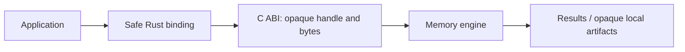

# Core SDK binding

Safe Rust adapter to the in-repository Core C ABI. This crate links through a relative Cargo dependency and is not published separately.

| ABI operation | Responsibility |
| --- | --- |
| `rs_core_abi_version` | Report the ABI epoch |
| `rs_core_create` | Create a thread-confined opaque handle |
| `rs_core_call` | Execute a versioned business request |
| `rs_core_call_with_transport` | Execute using borrowed synchronous host transport callbacks |
| `rs_core_model_load` | Initialize inference from borrowed model and tokenizer bytes |
| `rs_core_model_load_with_host` | Initialize with a synchronous host native-options callback |
| `rs_core_model_input_begin` | Reserve a bounded model upload for this handle |
| `rs_core_model_input_append` | Append the next bounded chunk at its exact offset |
| `rs_core_model_input_commit` | Consume the upload and initialize from its owned bytes |
| `rs_core_model_input_abort` | Cancel a pending upload and release its reservation |
| `rs_core_register_providers` | Let the host register installed native providers |
| `rs_core_buffer_free` | Release Core-allocated output |
| `rs_core_destroy` | Release the handle |

Business calls prepare opaque index data, query memories, return maintenance
results and check model health. Local index references remain opaque. Errors stay
explicit. The binding owns buffer/handle cleanup, and handles cannot cross threads.

In-repository Core provides model input stream contract 1. The default CPU-owned
ORT path reads model files in 1 MiB chunks, verifies length and SHA256 on the host,
and transfers ownership to Core. Profiling, GPU/NPU and the explicit legacy CPU
setting retain borrowed ONNX initialization. Stream contract 1 responses carry
`schema_version: 1` and an empty `request_id`; the synchronous ABI call, upload
ticket and append offset identify the operation. The binding validates this
envelope for successful begin, append, commit and abort responses; nonzero ABI
status codes are rejected before the envelope check.

The public host adapter owns model discovery, file reads, engine configuration and
opaque artifact persistence. Core receives model/tokenizer buffers and explicit
configuration; it never receives paths, database names, account keys or environment
variables. The adapter preserves existing `rsi1:` locators and checks their SHA-256
before passing opaque contents into Core. Only Core interprets the index format.
Changing the persistence boundary does not change the quantized model's index
generation. Calls from additional threads reuse the resident model in memory.
Query and association settings contain only explicit host overrides. Core retains
the default policy and applies it when a setting is absent.

See [direct source builds](../../SOURCE-BUILD.md). Cargo links actual Core source and checks local platform ABI, panic, and CRT requirements. The adapter stages native runtime files and embeds their expected SHA-256 digests. On Windows the build verifies and embeds Microsoft Windows ML 2.4.89 and checks its byte-exact license.

Association writes require `related_business` capability and association contract 1.
See [association compatibility](../../docs/associations.md).
